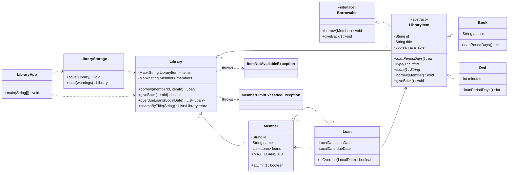

# Library Management System: Mini-Project Report

## 1. Overview
A console application (Java 21) that manages books and DVDs, members and loans. It applies the concepts from Labs 1 to 11: encapsulation, inheritance, abstraction, interfaces, polymorphism, custom exceptions, collections, streams and CSV file I/O.

## 2. Class diagram

## 3. Design decisions

| Requirement | How it is met |
|---|---|
| Private fields, validation, `toString` | Every field is `private`. Constructors reject blank ids, names and titles, and non-positive DVD times, with `IllegalArgumentException`. |
| Abstract `LibraryItem`, `Book`, `Dvd` | `loanPeriodDays()` is abstract. A `Book` is lent for 21 days and a `Dvd` for 7. `type()` and `extra()` let storage write any item without `instanceof` checks. |
| `Borrowable` interface | `LibraryItem` implements it. `borrow` throws `ItemNotAvailableException` if the item is already out. |
| Custom exceptions | Both are **checked** exceptions, so the compiler forces callers to handle them. The 3-loan limit is the `MAX_LOANS` constant on `Member`. |
| `Map` collections by id | `Library` keeps `Map<String, LibraryItem>` and `Map<String, Member>`, giving O(1) lookup by id. |
| CSV persistence | `LibraryStorage` writes `items.csv`, `members.csv` and `loans.csv` on exit and reloads them on start. Fields containing commas or quotes are escaped, so a title like `Hello, World` survives a round trip. Bad lines are skipped with a warning rather than crashing. |
| Menu with streams | Search uses `filter`, `sorted` and `toList`. The overdue report and the loan listing also use streams. |

**Key choices**
- **Validate before mutating.** `Library.borrow` checks the member limit, then item availability, and only then changes state. A failed borrow never leaves an item marked unavailable with no loan recorded (tested).
- **Separation of concerns.** `LibraryApp` only reads input and prints. Rules live in `Library`, file handling in `LibraryStorage`, so each class has one responsibility.
- **Encapsulated loan list.** `Member.getLoans()` returns an unmodifiable view, so outside code cannot get round the 3-loan limit.
- **Testable dates.** `borrow` and `overdueLoans` accept a date parameter, so overdue logic is tested without waiting weeks.
- **Patterns used only where the problem exists.** Polymorphism handles loan periods. A Factory could replace the `switch` in `LibraryStorage.load`, but with two item types it would add classes without solving a real problem. A Singleton for `Library` was rejected because it would make testing harder.

## 4. Testing
`test/LibraryTests.java` is a dependency-free runner with 33 checks, all passing: validation, polymorphic due dates, both custom exceptions, no half-finished state after a failed borrow, return then re-borrow, overdue boundary (not overdue *on* the due date), case-insensitive sorted search, a full save/reload round trip including a tricky title, corrupt-file handling and first-run with no files. Two scripted menu sessions (including an app restart and a backdated loan) confirmed the behaviour end to end.

## 5. Known limitations and extensions
- Only **active** loans are saved. Return history is not kept (a `LoanHistory` log would add it).
- No fines, reservations or renewals.
- Saved CSV rows follow `HashMap` order. Sorting by id before writing would make files stable for diffing.
- Each menu action prompts field by field. A GUI or REST layer could reuse `Library` unchanged.
